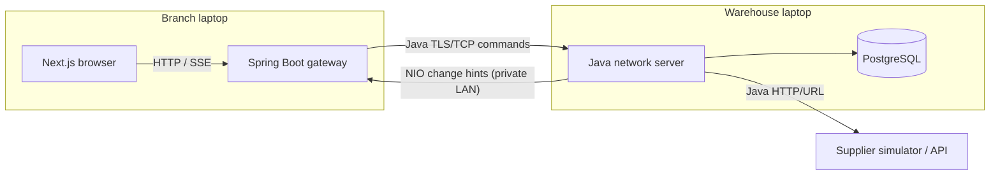

# ThogaMura

**Branch-to-central-warehouse stock coordination** — Java Network Programming Assignment 02.

> **Status: starter project and revised v2 design, not a completed application.** The Spring Boot/Next.js scaffolds do not yet implement business endpoints, sockets, supplier integration or NIO notifications. Each student must build/test/demonstrate their own feature.

## Why it exists

Shop/branch staff ask a central warehouse for stock. Two branches may compete for the last available items; an interrupted network request must be safely retried without a second reservation; all branch operators should promptly see state changes. When warehouse stock is unavailable, staff can check a **read-only supplier availability service** as an advisory next step. The coursework demo uses a separate synthetic supplier HTTP server; no commercial integration is implied.

## Stack

| Layer | Technology |
| --- | --- |
| Frontend | Next.js App Router, React, TypeScript, Tailwind |
| Branch API bridge | Spring Boot REST/SSE |
| Central Java networking | `java.net.Socket`/`ServerSocket`, `URI`/`HttpURLConnection`, `java.nio` channels/selectors, JSSE TLS |
| Server/DB | Spring Boot Java socket server, Spring JDBC, Flyway, PostgreSQL |
| Tests/development | Java 21, Maven, Node.js 22+, npm, Docker Compose, JUnit |

## Actual network topology



**Deployment:** Browser and gateway are together on the **branch-side** laptop; central Java socket server and database are on the **warehouse** laptop. NIO feed connects warehouse to branch gateways, is restricted to a **private demo LAN only**, and carries only change hints. Browsers refetch authoritative state through the TLS command path. **Do not expose plaintext NIO publicly.** Configured DNS/IP replaces pointless UDP discovery.

## Five individually demonstrable contributions

| Member | Networking concept | Real feature |
| --- | --- | --- |
| M1 | Java raw TCP sockets | Framed branch-to-warehouse requests, ambiguous timeout/retry |
| M2 | Java URI/URL + HTTP | Read-only supplier availability lookup via real separate HTTP endpoint |
| M3 | Java NIO selectors/channels | Non-blocking change invalidation to multiple branch gateways |
| M4 | ExecutorService and concurrency | Race-safe PostgreSQL stock reservation and durable request idempotency |
| M5 | JSSE/TLS | Server certificate verification and secure command sockets |

Each gets a success and failure network demonstration. See [Detailed v2 rationale](docs/NETWORK_FEATURES_V2.md), [workload ownership](docs/TEAM_WORKLOADS.md) and [assignment alignment](docs/ASSIGNMENT_ALIGNMENT.md). Lecturer approval is pending.

## Docs

- [Start here](docs/START_HERE.md)
- [Problem and scope](docs/PROJECT_CONTEXT.md)
- [Architecture](docs/ARCHITECTURE.md)
- [Backend and data](docs/BACKEND_PLAN.md)
- [Frontend and accessibility](docs/FRONTEND_PLAN.md)
- [TCP/NIO protocol](docs/contracts/NETWORK_PROTOCOL_V1.md), [HTTP API](docs/contracts/HTTP_API_V1.md), and [supplier HTTP contract](docs/contracts/SUPPLIER_HTTP_V1.md)
- [Five-week roadmap](docs/ROADMAP.md), [test matrix](docs/TEST_PLAN.md), [live demo](docs/DEMO_SCRIPT.md)
- [AI collaboration](docs/ai/CONTEXT_PACK.md) and [agent rules](AGENTS.md)
- [Original proposal](docs/proposal/README.md) (historical, superseded)
- [Decision log](docs/decisions/DECISION_LOG.md)

## Repository structure

```text
backend/
  protocol/        # shared command envelope
  network-server/  # TCP/TLS, NIO feed, supplier HTTP, concurrency, PostgreSQL
  api-gateway/     # Spring REST/SSE and Java TCP/NIO clients
frontend/          # Next.js web UI
docs/              # authoritative v2 specs, contracts and evidence instructions
reports/           # final PDF report and observed demo evidence (later)
compose.yaml       # local PostgreSQL development only
.env.example       # development environment variables
```

## First local commands

Prerequisites: Java 21, Maven 3.9+, Node.js 22+, Docker Compose.

```bash
cp .env.example .env
# Set a unique local Postgres password in .env.
docker compose up -d db
mvn -f backend/pom.xml clean verify
npm --prefix frontend ci
npm --prefix frontend run dev
```

Next.js starter opens at http://localhost:3000. The starter has no stock request listeners/commands yet; commands above are **not** proof of end-to-end workflow. See [setup](docs/SETUP.md).

## Group rules

1. No real keys, user/customer data, `.env`, DB volumes or keystores committed.
2. No shortcut from browser/gateway to DB. Commands cross actual Java TLS/TCP.
3. A negative test and real cross-process demo for every student's lecture feature.
4. M2 supplier simulator is a mock network **service**, not pretend static data in the production connector.
5. Keep NIO port 7444 on private/demo LAN only. HTTPS + authorization + encrypted NIO feed required before real public deployment.
6. Changes to contracts need ADR and group review. Avoid giant AI-generated work with unclear member ownership.

Repository: https://github.com/Suthankan1/ThogaMura
